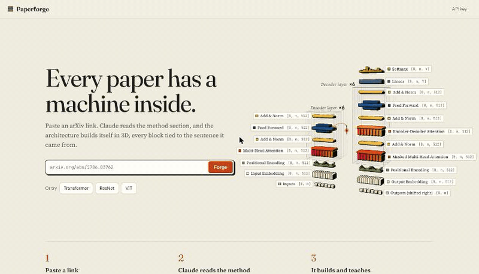

# Paperforge

**Paste an arXiv link, and AI reads the paper and builds its neural network in 3D, block by block, right in front of you.**

Everyone has a paper they never fully understood. Paperforge turns the method section into something you can watch and touch: the page flips, the key sentences light up, and the pieces of the model fly out of the text and click together into a 3D architecture. Every block carries its equation and tensor shape. Hover any block to see the exact sentence from the paper it came from.

## Demo



> _GIF coming soon._ To see it now, run it locally (below) and open
> http://localhost:3000/?paper=1706.03762

What happens in the clip:

1. Paste `https://arxiv.org/abs/1706.03762` ("Attention Is All You Need").
2. The paper appears, and highlights sweep across the sentences that define each part of the model.
3. Embeddings, multi-head attention, feed-forward blocks and the rest fly out of the text into an exploded view.
4. They snap together into the full encoder-decoder, with the ×6 stacked layers, residual connections, and the link from encoder to decoder.
5. A pulse of data runs from the input tokens up to the output probabilities.

## How it works

```
arXiv link ──▶ download PDF ──▶ pdf.js pulls out the text, page by page
                                   │
                                   ▼
                Claude reads the paper and returns a typed block graph:
                blocks (type, equation, tensor shapes, hyperparameters,
                a verbatim source sentence), edges, and repeated groups
                                   │
                                   ▼
              each source sentence is found in the page text ──▶ browser
                                   │
                                   ▼
         Three.js lays the graph out like the paper's figure and animates it
```

- **Server:** [Bun](https://bun.sh) + TypeScript, [pdf.js](https://mozilla.github.io/pdf.js/) for text extraction, [Claude](https://www.anthropic.com/claude) (`claude-opus-5-5`) with structured outputs, so the response always matches the graph schema in `src/shared/graph.ts`.
- **Front end:** [Three.js](https://threejs.org) for the scene, [KaTeX](https://katex.org) for equations. No framework.
- Results are cached in `data/cache/`, so a paper only gets read once.

## Run it

You need [Bun](https://bun.sh) (tested on 1.4).

```bash
git clone <this repo> paperforge
cd paperforge
bun install
bun run dev
```

Open http://localhost:3000 and click **Attention Is All You Need**.

That example works out of the box: its block graph ships in `samples/`, so you don't need an API key to see the demo. (The sample was written by hand to the same schema Claude produces, and once the paper has been downloaded, `bun test` checks every quote in it against the real paper text.)

To forge **any other paper**, add an [Anthropic API key](https://console.anthropic.com/):

```bash
cp .env.example .env   # then paste your key into .env
bun run dev
```

Reading a paper takes a minute or two the first time, and it's instant after that.

### Other commands

| Command | What it does |
| --- | --- |
| `bun run forge <arxiv-link> [--refresh]` | Run the pipeline in the terminal and print the extracted blocks |
| `bun test` | Unit tests: link parsing, quote matching, layout, sample checks |
| `bun run typecheck` | TypeScript check |

Settings in `.env`: `ANTHROPIC_API_KEY` (required to read new papers), `PAPERFORGE_EFFORT` (`low`, `medium` (the default), or `high`; higher is slower but more careful), and `PORT`.

### Viewer controls

Drag to orbit and scroll to zoom. Click a block to open the paper at its sentence. Press **Space** to skip the assembly animation. **Explode** pulls the model apart, and **Replay** runs the build again. Share a link straight to a paper with `?paper=<arxiv id>`.

## Limitations

- Paperforge works best on papers with one clear architecture figure (Transformers, ResNets, ViTs, U-Nets). Papers about training methods or theory have less to build.
- Claude can make mistakes. Every block shows its source sentence so you can check it against the paper.
- Text comes from the PDF, so equations inside the PDF can come through garbled. Equation labels are written by Claude, not copied from the PDF.

## License

Paperforge is open source under the [MIT License](LICENSE). Use it, fork it, and build on it.

Papers belong to their authors. Paperforge downloads them from arXiv when you ask for them and never redistributes them.
